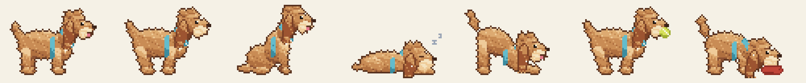

# Marsy Poo 🐾 — make your own pixel desktop pet

A tiny pixel-art pet that lives above your Dock on macOS and nudges you to take care of yourself. It started as **Mars**, my apricot doodle. Fork it and make it yours: swap the art, change one JSON file, switch features on and off. No Swift needed.

<p align="center"></p>

## What it does

The pet wanders along the bottom of your screen: walks, sits, sniffs, naps. Click to pet it (hearts!) or drag it around. It never blocks your clicks except on itself. Throughout the day it runs small **moments**:

| Moment | When | You |
| --- | --- | --- |
| 📸 **Photo drop** | Once a day | It brings you a polaroid of a random photo from `~/Pictures/<Pet> Photos/`. Click it to see it big. |
| 🍖 **Meals** | Breakfast, lunch, dinner | Drag the kibble and water onto its bowls. Then it reminds *you* to eat. |
| 🎾 **Fetch** | Every 50 min of screen time | Fling the ball; it chases it and brings it back. A break for your eyes. |
| 🗂️ **Tidy** | On demand | It carries your Desktop screenshots into a Screenshots folder (with Undo). |
| 💬 **Status bubbles** | Whenever | Any script can make it say something, e.g. "Claude's done!" from a Claude Code hook. |

Everything is in the menu bar (with a snooze-everything button), times are in Settings, and nothing leaves your Mac. No accounts, no network.

## Run it

You need macOS 13+ and Xcode or the Command Line Tools (`xcode-select --install`).

```bash
git clone https://github.com/jenxguo/desktop-pet.git
cd desktop-pet
swift run
```

Making your own pet? Click **Fork** on GitHub first and clone your fork instead, so you can push your pet's art.

The first build takes about 30 seconds. Then the pet shows up above your Dock, with a 🐾 in the menu bar. `swift run` keeps running in that terminal until you quit: choose **Quit Mars** from the menu bar, or press **Ctrl+C** in the terminal.

The first time the pet tidies screenshots, macOS asks whether Terminal (or the pet's app) can access your Desktop folder. Click **Allow**, or tidying can't move anything.

To keep it, build a real app and drag it into /Applications:

```bash
./scripts/build-app.sh
open "build/Mars.app"
```

## Make your own pet

Everything about the pet lives in **`Pet/`**:

```text
Pet/pet.json      name, pronouns, which moments are on, schedule, colors, every line of text
Pet/sprites/      the animation frames (stand, walk, run, sit, sleep, …) + a portrait
Pet/props/        bowls, kibble, ball, folder
```

1. **Take 1–5 photos of your pet.** The key one is a side view of the whole body. ([What to shoot](docs/MAKE_YOUR_OWN_PET.md#1-take-a-few-photos))
2. **Make the frames**, whichever way you like:
   - **With Claude Code:** open the repo and run `/make-my-pet`, then drop in your photos. Claude writes code that draws your pet in pixel art, checks it and iterates with you.
   - **With an AI image generator:** use the [ready-made prompts](docs/MAKE_YOUR_OWN_PET.md#route-b-an-ai-image-generator--toolspixelatepy), then `tools/pixelate.py` snaps the results onto a real pixel grid with a consistent palette.
   - **By hand** in [Piskel](https://www.piskelapp.com) (free) or Aseprite, or by tracing video frames.
3. **Edit `Pet/pet.json`.** A whole valid file can be as small as:

   ```json
   { "name": "Biscuit", "pronouns": { "they": "he", "them": "him", "their": "his" }, "features": { "fetch": false } }
   ```

4. **Check and run:**

   ```bash
   python3 -m venv .venv && source .venv/bin/activate   # once; later, just `source .venv/bin/activate`
   pip install -r tools/requirements.txt                  # Pillow + numpy
   python3 tools/check_pet.py      # catches size/ground-line/mouth mistakes, draws build/pet-preview.png
   swift run
   ```

   The virtual environment (`.venv`) keeps this working on any Python, including Homebrew's, which refuses a plain `pip3 install` with an "externally-managed-environment" error.

The full guide is in **[docs/MAKE_YOUR_OWN_PET.md](docs/MAKE_YOUR_OWN_PET.md)**: photo list, every frame, prompts, all `pet.json` keys, and tips for cats and other non-dogs.

Only `stand.png` is required. Any frame you skip gets a stand-in, so you can start with one drawing and add more later.

## Turn features on and off

- **For your fork:** `"features": { "fetch": false }` in `pet.json` removes a moment completely (no menu item, no setting, no art needed). Also `photoDrop`, `meals`, `tidy`, `statusBubbles`.
- **For yourself, day to day:** Settings → Moments has a toggle for each one, plus all the times.
- **Add your own:** each moment is one file in `Sources/DesktopPet/Moments/`. See [docs/ADDING_A_MOMENT.md](docs/ADDING_A_MOMENT.md) (a 40-line "hourly stretch" example).

## Status bubbles (e.g. from Claude Code)

Drop a text file into the pet's folder and it says the text in a speech bubble:

```bash
echo "Claude's done!" > ~/Library/Application\ Support/Mars/Notifications/$(date +%s).txt
```

(Use your pet's name in place of `Mars`.) To get a ping whenever Claude Code finishes, add a `Stop` hook to `~/.claude/settings.json`:

```json
{
  "hooks": {
    "Stop": [{ "hooks": [{ "type": "command",
      "command": "echo \"Claude's done!\" > \"$HOME/Library/Application Support/Mars/Notifications/$(date +%s).txt\"" }] }]
  }
}
```

## How it's built

Native Swift: SwiftUI for the menu bar and Settings, SpriteKit for the pet, inside one borderless, transparent, click-through `NSPanel` over the screen.

```text
Pet/                         ← your pet (art + pet.json); read at launch, no rebuild needed
Sources/DesktopPet/
  App/                       menu bar, app delegate
  Pet/                       PetConfig (pet.json), PetSprites, PetSettings
  Scene/                     PetScene (wander, petting, dragging, helpers), OverlayWindow
  Moments/                   PhotoDrop, Meal, Fetch, Tidy: one file each
  UI/                        Settings window, polaroid card
  Support/                   photo folder, screenshot finder, status-bubble watcher
tools/
  check_pet.py               validate Pet/ + preview sheet
  pixelate.py                big image / AI art → real sprite frame
  make_icon.py               portrait → app icon (used by build-app.sh)
  examples/make_mars_sprites.py   how Mars was drawn, in code
scripts/build-app.sh         → build/<Name>.app
```

## Sharing your build

`build-app.sh` signs the app ad hoc, which runs fine on the Mac that built it. To send the `.app` to friends without "unidentified developer" warnings, you need an Apple Developer ID to sign and notarize it. Otherwise they can fork the repo and run it themselves (that's the fun part anyway).

## License

MIT: see [LICENSE](LICENSE). Mars's art is included as the example pet. Please swap in your own pet rather than shipping Mars as yours. 🐶
